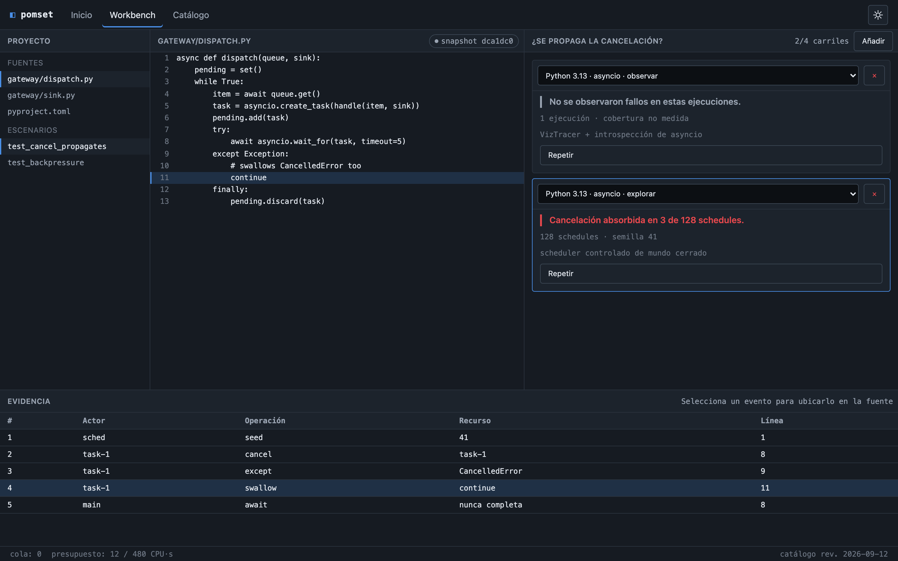
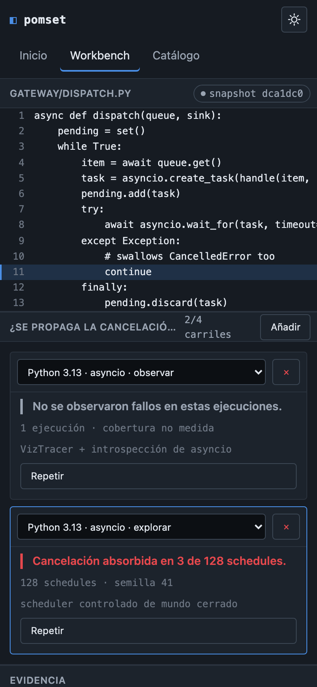

# pomset · mock de interfaz

Maqueta navegable de pomset, un workbench web para correr y revisar programas
concurrentes sin instalar nada. HTML, CSS y JavaScript sin frameworks.

**Sitio:** https://pomset.vercel.app
**Producto:** rama [`main`](https://github.com/miguelcsx/pomset/tree/main)

## Por qué existe

pomset está diseñado pero no construido. Esta rama toma la parte visible y la
vuelve clicable, para resolver cómo se ve y cómo se comporta antes de escribir el
producto.

El problema que ataca pomset: revisar concurrencia hoy implica un toolchain por
lenguaje. VizTracer si usas asyncio. Shuttle si usas Tokio. Faial para CUDA. Cada
uno reporta a su manera y comparar resultados entre ellos es trabajo manual.
pomset los pone detrás del mismo modelo de proyectos y evidencia.



## Qué hay

Tres páginas. `index.html` con los modos de análisis, ejemplos y el formulario de
importación. `catalog.html` con los perfiles disponibles y sus filtros.
`workbench.html`, que es donde está lo interesante.

El workbench abre ya ejecutado. Un archivo Python, dos perfiles corriendo sobre
él, dos respuestas distintas. El de observación reporta "No se observaron fallos
en estas ejecuciones" y al lado te dice que la cobertura no está medida. El de
exploración, mismo código, encuentra "Cancelación absorbida en 3 de 128
schedules". Haces clic en cualquier evento de la tabla de abajo y se marca la
línea correspondiente en la fuente.

Que esos dos veredictos se vean distintos importa. Una corrida sin fallos no
prueba que el programa esté bien, solo que en esa corrida no pasó nada, y la
interfaz no puede presentar las dos cosas igual. Por eso el verde nunca aparece
solo para decir "seguro".

## Decisiones

### Flexbox y Grid

Usé Grid en dos lugares. El workbench, que tiene tres zonas más un panel que
cruza todo el ancho abajo, está declarado con `grid-template-areas` en
`css/workbench.css`. La ventaja es que adaptar el layout en cada breakpoint
significa reescribir el mapa de áreas y ya, sin mover el orden del HTML. El
catálogo también va con Grid, `repeat(auto-fill, minmax(300px, 1fr))`, que
reacomoda columnas según el ancho disponible y me ahorró dos media queries.

Flexbox quedó para las filas donde los elementos se reparten el espacio entre
ellos: la barra de cada panel, el header, la barra de estado, el encabezado de
los carriles. Ahí el patrón siempre es el mismo, título a la izquierda y
controles empujados a la derecha con `margin-left: auto`.

### El JavaScript

Cuatro módulos.

`js/profiles.js` guarda el catálogo completo. Es un arreglo de objetos y es el
único sitio donde están esos datos, así que cuando exista la API de la Entrega 2
se reemplaza por la respuesta del servidor sin tocar el código que dibuja.

`js/catalog.js` filtra y pinta las fichas. La función que filtra recibe la lista
y los criterios y devuelve otra lista; no conoce el DOM.

`js/import-form.js` valida el formulario. Cada campo tiene una lista de
comprobaciones asociada en un objeto `rules`, así que agregar un campo nuevo es
agregar una entrada ahí, sin escribir un `if`.

`js/workbench.js` es el más largo, 278 líneas. Lleva el estado de los carriles y
lo dibuja.

### La validación

El formulario tiene `novalidate`. La burbuja nativa del navegador aparece donde
el navegador quiere y se va sola, y yo necesitaba el mensaje pegado al campo y
persistente.

Cada campo arranca con un `required` y después vienen las comprobaciones de
formato. Esas segundas ignoran el campo vacío a propósito: si no, al enviar
vacío te salen dos errores por el mismo campo y queda ruidoso.

Cuando envías se juntan los valores, se validan todos, se pintan los errores de
golpe y el foco salta al primero que falló. Si empiezas a escribir en un campo su
error desaparece. Todo eso va acompañado de `aria-invalid` para que un lector de
pantalla reciba lo mismo que se ve.

### Por qué el mock está en otra rama

`main` es el repositorio del producto y el frontend real va a ser React con
Monaco. Este mock es plano y va a morir
cuando exista el de verdad. Mezclarlo con `main` habría dejado archivos
condenados en el repo del producto, así que vive en `web/mock` y Vercel publica
esa rama.

Eso trae un costo: el header está repetido en los tres HTML. Sin build no hay
includes. La opción era inyectarlo con JavaScript, pero entonces el navegador
recibe un documento sin estructura en el primer render, y eso pesa 15 puntos de
la rúbrica. Doce líneas duplicadas salen más baratas.

## Uso de IA

Usé Claude Code para escribir la mayor parte del código. La dirección la puse yo:
el dominio, de dónde sale el contenido, y qué se muestra en pantalla.

Rechacé varias versiones antes de esta. La peor: el selector de perfiles del
workbench ofrecía Rust y CUDA sobre un archivo Python. Además de no tener
sentido, es justo lo que el producto no debe hacer: ofrecerte algo parecido
cuando lo que pediste no aplica. Ahora el selector solo muestra lo que el
lenguaje del escenario admite.

También boté la primera versión del workbench completa. Abría vacía, con dos
dropdowns y un botón de ejecutar, y no se entendía qué estabas viendo ni para qué
servía. De ahí salió la idea de abrir con la comparación ya hecha.

Lo tercero fue el texto. Sobraba en todas las pantallas, con párrafos que
explicaban cosas que la interfaz ya estaba diciendo. Recorté casi todo y cambié
etiquetas por iconos donde el icono alcanzaba.

## Lo más difícil

Mantener el estado de los carriles coherente sin framework.

Hay cuatro cosas cambiando al mismo tiempo: qué carriles existen, en qué etapa va
cada uno, cuál está activo, y qué fila de evidencia está seleccionada. Mi primera
versión iba actualizando el DOM por pedazos. Cambiaba el texto de la etapa por un
lado, la clase del carril activo por otro. Funcionaba hasta que dos cosas pasaban
juntas. Cancelar un carril mientras otro terminaba dejaba la barra de etapas de
uno pintada con el estado del otro y me tomó un rato entender por qué.

Terminé haciéndolo al contrario: un objeto con todo el estado, y una sola función
`render()` que redibuja los tres paneles desde ahí. Cualquier handler cambia el
estado y llama a `render()`. Es menos eficiente porque redibuja de más, y con
listas largas no serviría, pero con cuatro carriles ni se nota.

El efecto secundario fue que los listeners se morían en cada redibujado, porque
el `innerHTML` bota los nodos viejos. Lo resolví con delegación: un listener por
panel, que mira qué elemento recibió el clic.

## Accesibilidad

Objetivo WCAG 2.2 AA. Todo se puede recorrer con teclado, incluidas las filas de
evidencia, que responden a Enter y espacio. El foco se ve siempre, con un borde
de 2px que no usa el color de diagnóstico para no confundirse con un error. Las
transiciones respetan `prefers-reduced-motion`.

## Responsive



Arriba de 1280px se ven los tres paneles.
Entre 900 y 1280 se colapsa el árbol de archivos, que es lo primero de lo que
puedes prescindir. Abajo de 900 los paneles se apilan.

A 320px nada se desborda. Lo que no cabe, como la tabla de evidencia o el código,
desplaza dentro de su propio panel sin arrastrar la página.

## Correrlo

```bash
git clone -b web/mock https://github.com/miguelcsx/pomset.git
cd pomset
python3 -m http.server 4174
```

Sin build ni dependencias.

## Licencia

Apache-2.0.
