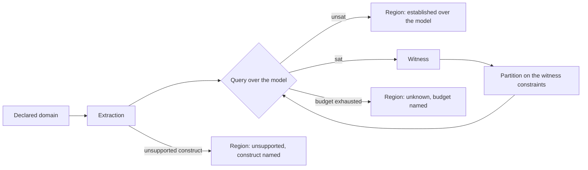
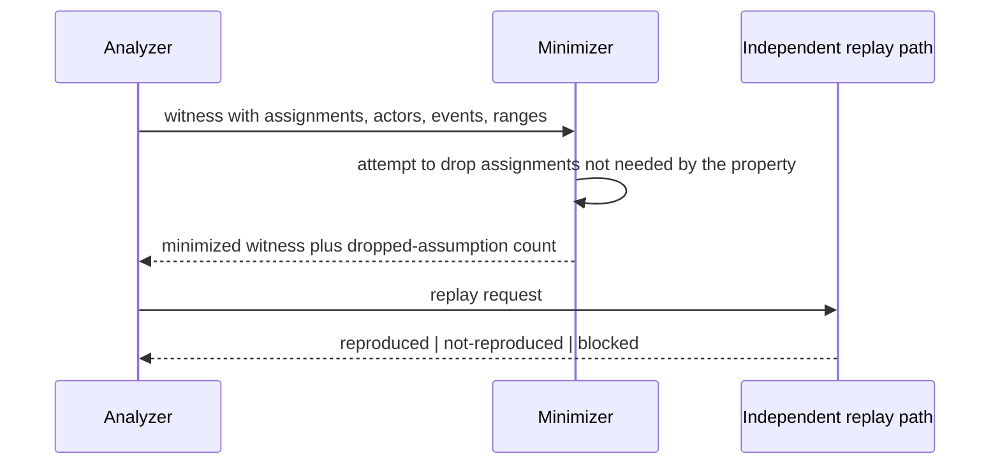

# Exploration and validation

Domain partitioning, sampling, replay, numerical reference comparison, output
poisoning, and the eligibility policy that decides what counts as satisfied.
Requirements: [`../srs/exploration.md`](../srs/exploration.md),
[`../srs/validation.md`](../srs/validation.md),
[`../srs/performance.md`](../srs/performance.md). Decision:
[`../adr/0010-performance-and-eligibility.md`](../adr/0010-performance-and-eligibility.md).

## From a domain to regions

The user declares a domain: variables over shape, dtype, layout, launch and
hardware, plus constraints. The explorer's job is to replace "the domain" with a
small set of **regions** that behave alike, each with per-property
classifications.

A classification is `established`, `violated`, `sampled`, `unknown` or
`unsupported`, and it belongs to one property in one region. There is no
aggregate verdict for the domain.

**No fictitious percentages.** A count or percentage exists only for a finite,
explicitly enumerated domain with duplicate points removed. Otherwise the report
states constraints and sampled points and gives no proportion at all.

## Sampling strategies

| Strategy | Availability | Records |
|---|---|---|
| Exhaustive | Only over an enumerated finite domain. | Every point. |
| Random | Always. | Strategy revision, seed, budget, chosen points. |
| Boundary | Always; emphasizes values near constraint edges. | Same. |
| Partition-guided | Always. | Same, plus the partition derivation. |
| Counterexample-guided | Always. | Same, plus the witness that redirected the search. |

All five are reproducible from `(strategy, strategyRevision, seed, budget)` alone.
Nothing depends on wall-clock time, process identity or iteration order. This is
what makes a CI comparison meaningful across machines.

Sampling finds counterexamples. It does not establish their absence, and no
sampled region is ever relabelled `established`.

## Counterexample-guided partitioning

The premise of the exploration method is that the constraints under which
behaviour changes are the interesting object. A witness supplies them:

1. The query returns `sat` with a witness naming the assignments that break the
   property.
2. The constraints implied by that witness — for example "N modulo BLOCK is not
   zero" — become a region boundary.
3. The next query is restricted to the complement, and the process repeats while
   the budget allows.

The result is a partition in which every boundary is justified by a concrete
witness rather than by uniform sampling. Whether this beats exhaustive or random
sampling on cost, precision, coverage and witness size is a **measurement
obligation** on the feasibility gate, not an assumption in this document.

## Replay and minimisation

Minimisation never drops an assumption the result depends on. A failed or blocked
replay is recorded with its reason, not omitted; a missing tool or device is a
blocker and is named.

Replay classification matters:

| Replay path | What it supports | What it does not support |
|---|---|---|
| CPU interpreter | The modelled numerical behaviour, within the interpreter's documented limits. | GPU scheduling, race freedom, GPU timing. |
| Native run | The native tool's genuine observation. | Anything the tool's coverage does not reach. |
| Instrumented run | Observed coverage under instrumentation. | Race freedom; unperturbed timing. |

## Numerical reference comparison

A comparison states:

- the reference: kind, path and symbol;
- the dtype used for comparison;
- absolute and relative tolerances;
- the NaN and Inf policy;
- the first differing element, with observed and expected values on disagreement.

Executing a reference requires local execution consent. A scenario may declare a
reference without consenting to run it, in which case the check is `blocked`.

### Fresh or poisoned output

This is the mechanism that stops an unwritten output from hiding:

1. The output buffer is freshly allocated or filled with a poison pattern.
2. The kernel runs once against it.
3. The comparison runs against the poisoned buffer.

A reused autotune buffer can otherwise retain a previous run's values and mask a
missing write entirely — the failure mode that motivates this whole property. The
record states whether a fresh buffer was used and whether autotuner buffer reuse
was in play.

## Eligibility policy

One policy, implemented once, used by the CLI, the API and the UI.

For each required property it states:

- the accepted methods;
- whether a sampled pass may satisfy it;
- whether an `unknown` result may satisfy it.

For benchmarking it states whether an eligible validation record is required,
whether the metric must be measured rather than estimated, the required cohort
match, a minimum sample count and whether warm-up is required.

Rules:

1. Unknown or unsupported required checks **block** automatic eligibility.
2. A user may change the policy to accept them; the report records the policy
   revision and **the unchanged evidence class**. Policy changes re-label, they
   never upgrade.
3. A recommendation requires exact compatible snapshot, scenario, profile, domain
   and policy identities, satisfied declared required checks, complete
   provenance, a measured metric, and a compatible hardware cohort.
4. Imported evidence stays `origin: imported`, may be admitted by explicit policy,
   and never becomes provider-produced proof.

## What this document does not claim

It does not claim that the exploration method is novel or better. It describes a
mechanism whose benefit must be measured against exhaustive, random and boundary
strategies on real and reconstructed defect cases, in
[`../evaluation/methodology.md`](../evaluation/methodology.md).
