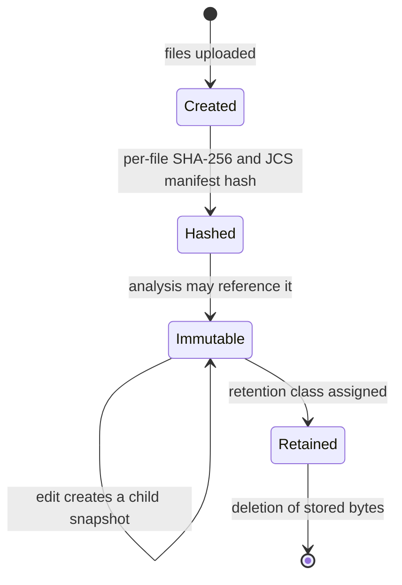
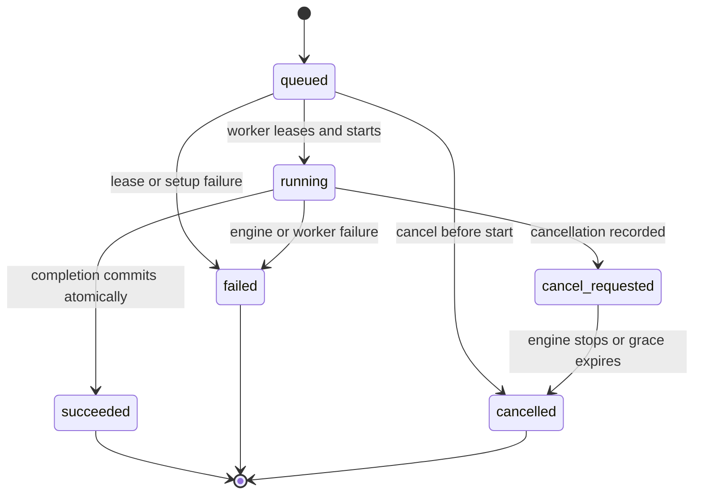
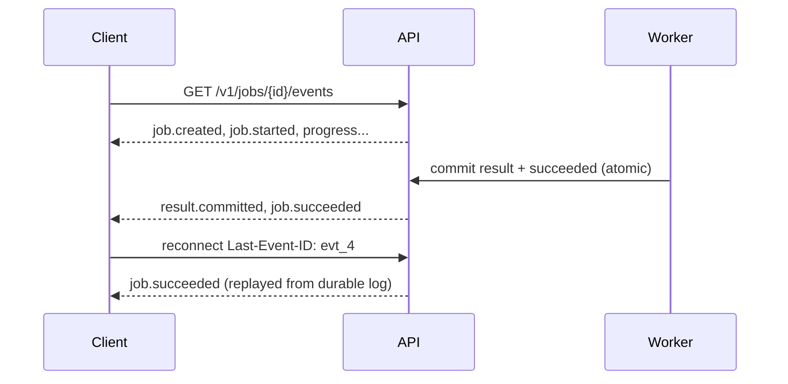

# Lifecycle, identity and caching

Ownership, snapshot and job transitions, leasing, cancellation races, artifact
finalisation, retention, revocation, and cache identity. This document is the
single owner of those rules. Requirements:
[`../srs/engine-protocol.md`](../srs/engine-protocol.md),
[`../srs/platform.md`](../srs/platform.md), [`../srs/sharing.md`](../srs/sharing.md).

## Ownership

An owner is a server-side record mapping `(issuer, subject)` from the identity
provider to an opaque `ownerId`. Caller-supplied owner identity is data, never
authorization. Every project, snapshot, job, result, measurement, artifact and
publication belongs to exactly one owner for its whole life; ownership is not
transferred.

Content identity is separate. Two owners may hold byte-identical artifacts;
internal deduplication exists so that identical bytes are stored once, and it
must not reveal that fact to either owner.

## Snapshot lifecycle

- A snapshot is created from an explicit file set. Each file's original bytes are
  hashed with SHA-256; the manifest's own hash is computed over its RFC 8785 JCS
  serialization with the hash field omitted.
- A snapshot is immutable from creation. **Editing creates a child snapshot**
  with `parentSnapshotId` set. No job or result is ever retargeted.
- Snapshots are validated on the way in: normalized POSIX relative paths, no
  symlinks, no escaping, no duplicate paths.

## Job lifecycle

Rules that make the diagram true:

1. **One job, one attempt.** `attemptId` is the immutable process-execution
   identity. A rerun is a new job. There is no automatic retry.
2. **Completion cannot outrun a recorded cancellation.** Completion wins only if
   it commits before the cancellation request is recorded. Once cancellation is
   recorded, a later completion cannot produce `succeeded`.
3. **Atomic commit.** Result references and the terminal state are committed in
   one transaction. A crash between them leaves the job in its previous state,
   which the lease then resolves.
4. **Terminal states are immutable.** Late engine messages after finalisation or
   after lease loss are rejected, never applied.
5. **Partial evidence survives.** Evidence accepted before the cancellation was
   recorded is retained with its actual completeness and a partial qualifier. It
   is never promoted to a complete successful result.
6. **Cancellation finalises deterministically.** With a recorded cancellation,
   engine death or grace expiry finalises `cancelled`. Lease expiry without a
   recorded cancellation finalises `failed` with `WORKER_LOST`.

## Leasing

| Parameter | Value |
|---|---|
| Heartbeat interval | 5 s |
| Lease validity | 30 s |
| Cancellation and lease poll | at most once per 1 s |
| Cooperative cancel grace | 2 s, then process-tree kill |

Every write presents the active lease fencing token. A worker whose lease
expired has no authority, even if it later finishes its work: its writes are
rejected and the job has already been finalised. This is what makes worker death
a normal event rather than a corruption source.

## Event stream

Events are durable and append-only, ordered by a per-job sequence starting at 1.
Progress and accepted evidence chunks are never modified or retracted. A client
reconnects with `Last-Event-ID`; server-side authorization on reconnect is
identical to the original request; events after that id are replayed. If the
cursor has expired, the server signals it and instructs the client to fetch
current job state rather than fabricating a replay.

## Artifacts

An artifact is an immutable manifest: kind, content hash, byte count, media type,
producing revision, retention class. Retrieval is authorized per request against
ownership or against a publication that includes it. Guessing a content hash
grants nothing.

Retention classes are `job`, `project`, `publication` and `permanent`. Deleting
stored bytes and revoking access are different operations with different
guarantees:

| Operation | Effect | Does not mean |
|---|---|---|
| Delete stored bytes | The content is gone from this deployment. | That a third party's copy is gone. |
| Revoke publication | Subsequent server retrieval is denied. | That already-downloaded copies vanished. |

## Cache identity

Cache keys are exact identity comparisons, never resemblance:

- **Analysis**: snapshot, scenario, domain, policy revision, model revision and
  profile revision.
- **Measurement**: the analysis key plus device, tool, tool revision and
  environment identity, and the hardware cohort.

A cache hit therefore means "the same question, asked of the same inputs, under
the same tooling". Nothing weaker is reused. A newer query model or solver
version is a different key; it may legitimately produce a different
established/unknown split, and the difference is reported rather than hidden.

Isolation follows from the same rule: a cached artifact is served only through an
authorized route, and its content identity never widens who may read it.
