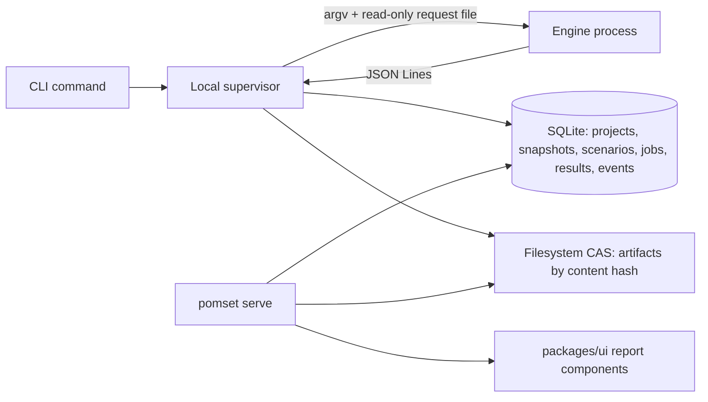

# Local and CI use

The `pomset` CLI: commands, manifest, storage, exit statuses and the read-only
viewer. Requirements: [`../srs/local-ci.md`](../srs/local-ci.md). Decisions:
[`../adr/0011-private-local-and-publication.md`](../adr/0011-private-local-and-publication.md),
[`../adr/0006-jobs-and-persistence.md`](../adr/0006-jobs-and-persistence.md).

## Why it exists

Kernels are often proprietary, and a CI check that uploads source is unusable in
a company. The local path analyses source, stores results and renders reports
entirely on the user's machine: no network, no account, no telemetry, no implicit
upload. The hosted API and the CLI share the same portable contracts, the same
engine protocol and the same eligibility policy, so a scenario validated offline
behaves identically when hosted.

## Commands

| Command | Does | Never does |
|---|---|---|
| `pomset analyze` | Runs the requested analysis over the declared domain and writes a result. | Publishes; executes user code without consent when the analysis is purely static or symbolic. |
| `pomset validate` | Evaluates the declared required properties against the active policy. | Upgrades a sampled or unknown result. |
| `pomset benchmark` | Times eligible configurations. | Runs without an eligible validation record and `--trust-local-code`. |
| `pomset compare` | Compares validation and measurement outcomes between two named snapshots. | Re-labels the older result or compares across different domains. |
| `pomset import` | Validates and ingests a bundle or measurement. | Executes, publishes or trusts an invalid import. |
| `pomset export` | Writes a portable bundle. | Includes artifacts that were not selected. |
| `pomset serve` | Serves built reports read-only on loopback. | Starts, compiles or executes anything. |

## Manifest

Scenarios live in `pomset.json`, written in the canonical `Scenario` schema from
[`packages/contracts/schema/domain.schema.yaml`](../../packages/contracts/schema/domain.schema.yaml). The manifest
is the same document the hosted API accepts, so a CI check is reviewable in a diff
and portable to the service.

```json
{
  "schemaVersion": 1,
  "scenarioId": "scn_91Bx",
  "snapshotId": "snp_01HN3",
  "name": "transform output coverage",
  "entrypoint": { "path": "kernels/transform.py", "symbol": "transform" },
  "allocations": [
    { "allocationId": "al_y", "name": "Y", "role": "output", "dtype": "fp16",
      "shape": [{ "op": "parameter", "parameter": "N" }], "poisoned": true }
  ],
  "launch": {
    "grid": [{ "op": "ceilDivide", "operands": [
      { "op": "parameter", "parameter": "N" },
      { "op": "parameter", "parameter": "BLOCK" }] }],
    "block": [{ "op": "parameter", "parameter": "BLOCK" }],
    "displayHints": ["grid = (triton.cdiv(N, BLOCK),)"]
  },
  "domain": { "domainId": "dom_f8K2", "enumerable": true,
    "variables": [{ "name": "N", "kind": "shape", "type": "int", "width": "i32" }] },
  "requiredProperties": ["outputCoverage", "memoryBounds"]
}
```

The launch configuration is data — a restricted integer-expression tree — never a
host lambda. Parameter names resolve only to declared domain variables, divisors
must be positive under the constraints, and grid dimensions must be nonnegative.
Anything else is rejected explicitly.

## Storage



Snapshots, results, events and artifact manifests use the same schema versions as
the hosted service. Job coordination is direct supervisor invocation, because a
single machine does not need leases.

## Exit statuses

| Status | Meaning |
|---|---|
| 0 | The requested policy is satisfied. |
| 1 | An actual property or regression check failed. |
| 2 | Invalid input, an unsupported required analysis, an unknown required result, or an engine failure. |

Status 2 aggregates several distinct causes, so a machine-readable report is
always produced carrying per-property outcomes, error records with their codes,
the policy revision, the profile revision and the coverage — even when the status
is 2. The exit status is a summary; the report is the result.

A CI pipeline must be able to tell "the kernel is wrong" from "we could not tell",
which is exactly what statuses 1 and 2 keep apart.

## Consent and GPU

- `--trust-local-code` is required for any path that imports or executes user
  Python, native programs or reference computations, including numerical replay
  and benchmarking. Pure static or symbolic parsing requires no consent.
- GPU work runs only when the user explicitly opts in for that run. It is never
  enabled by configuration default, project file or shared bundle.
- No hosted GPU execution exists, and no web-to-local execution path is built.

## `pomset serve`

- Binds loopback only.
- Validates the `Host` and `Origin` headers and disables cross-origin access.
- Requires a random local read capability for private report APIs.
- Exposes no route that starts a job, compiles, or executes anything.
- Serves the same built `apps/web` report route and `packages/ui` inspector
  components used by the hosted workbench, over a read-only local transport.
- Write and job controls are unavailable with an explicit explanation naming the
  CLI command that performs the operation.

Opening an imported report, a bundle or a loopback URL never authorises execution.

## Reproducible CI

```yaml
# .github/workflows/pomset.yml  (planned example)
jobs:
  validate:
    runs-on: ubuntu-latest
    steps:
      - uses: actions/checkout@v4
      - run: uv python install 3.12.6 && uv sync
      - run: pnpm install --frozen-lockfile && pnpm build
      - run: pnpm pomset validate --manifest pomset.json --baseline ci/baseline.json --report pomset-report.json
      # 0 policy satisfied, 1 property or regression failure, 2 invalid, unsupported, unknown or engine failure
```

The recipe pins the tool and profile revisions it uses, keeps a named baseline
snapshot for regression comparison, and requires no hosted credentials. A
regression check that drifts is a check that will be ignored.
