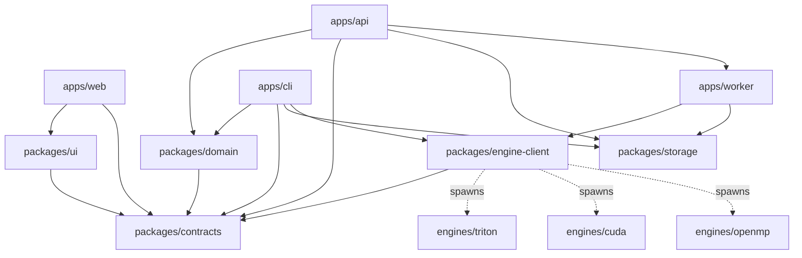

# Monorepo boundaries

The planned repository layout, the dependency directions it enforces, and the
build tooling that keeps two language ecosystems out of each other's way. Every
path below is an implementation target. Some packages exist partially; the
[audit](../evaluation/implementation-audit.md) records current limits and the
no-go gate. Sources: `SRC-029`, `SRC-030`, `SRC-031`.

## Planned tree

```text
apps/web/                       React + Monaco + Next.js client, statically exported
apps/api/                       Node.js + Express HTTP API and event stream, layered
apps/cli/                       TypeScript local/CI CLI and loopback report server
apps/worker/                    TypeScript engine supervisor / hosted job consumer
packages/contracts/             generated TS bindings + canonical moved schemas
packages/domain/                pure project/domain/evidence/eligibility policy
packages/ui/                    shared React workbench components and tokens
packages/storage/               local SQLite/CAS and hosted PostgreSQL/object store
packages/engine-client/         process protocol, not language analysis
engines/triton/                 Python AST subset analyzer + Z3 and replay adapters
engines/cuda/                   native tool adapters and CUDA semantics metadata
engines/openmp/                 native tool adapters and OpenMP semantics metadata
fixtures/kernels/               licensed tiny kernels + declared outcomes
infra/                          Linux sandbox images and deployment definitions
profiles/{backend}/{profileId}.json   immutable measured-compatibility manifests
```

## Dependency directions



`packages/domain` has **no** React, HTTP, persistence, GPU or solver imports. It
is pure policy: what a project is, what a domain is, what a result may claim,
and what the eligibility policy accepts. The API, the CLI and the worker all
reuse it, so the rules cannot drift between offline and hosted operation.

## Tooling

- **`pnpm` workspaces** for TypeScript. Root automation coordinates both
  ecosystems; a Python or native build is never forced through a JavaScript
  bundler.
- **`uv`** for Python engines. The Triton engine's environment is pinned and
  probed; see [`triton-engine.md`](triton-engine.md).
- **Pinning.** Tool and library versions are pinned after compatibility probes
  and recorded in lockfiles, image digests and profile revisions. A version
  mentioned in a reference implementation is a candidate, not a support claim.
- **No new compiler.** Native adapters invoke installed, pinned vendor and
  compiler tools.

## Storage duality

| Concern | Local CLI | Hosted |
|---|---|---|
| Metadata | SQLite | PostgreSQL |
| Artifacts | Filesystem, content-addressed | S3-compatible object store |
| Job coordination | Direct supervisor invocation | Leased PostgreSQL job rows |
| Network | None required | Required |

Both satisfy the same consumer-visible lifecycle defined in
[`lifecycle.md`](lifecycle.md). No distributed queue service is introduced
initially: leases over durable rows provide worker coordination, and
[`../adr/0006-jobs-and-persistence.md`](../adr/0006-jobs-and-persistence.md)
records why.

## Ownership of shared packages

| Package or concern | Owner | Notes |
|---|---|---|
| `packages/contracts` bindings, schema codegen and the error registry | FND | One canonical authority; see [`../adr/0004-contract-authority.md`](../adr/0004-contract-authority.md). |
| `packages/storage` lifecycle interface and cross-backend conformance | FND | Interface plus the conformance requirements both implementations must pass. |
| `packages/engines/` protocol, limits, cancellation conformance | TRI | The engine implementation and `packages/engine-client` together. |
| `packages/domain` required-property and measurement eligibility policy | LOC | Implemented once; consumed by local and hosted alike. |
| Hosted storage and supervision consumers | HST | Uses the same interfaces; does not fork the policy. |
| `profiles/{backend}/{profileId}.json` capability manifests | FND | Measured revisions are immutable files; live availability derives from deployment state and never rewrites a support claim. |

## Process boundaries

- **JSON Lines over child-process stdin and stdout** is the engine boundary.
  stderr carries bounded diagnostics and is not a second protocol. See
  [`../srs/engine-protocol.md`](../srs/engine-protocol.md).
- **No Python HTTP microservices.** An engine is a child process, not a service.
- The **worker** owns process cancellation and resource limits. Python and
  native engines own analysis only: no user accounts, no publication rights, no
  network access when hosted.

## Rationale for building rather than reusing

The product is incomplete; target boundaries remain the architecture contract.
What is
reused is the external tooling — solvers, sanitizers, compilers, profilers —
behind adapters, in line with
[`../adr/0009-backend-semantics.md`](../adr/0009-backend-semantics.md).

## Current browser feature boundaries

`apps/web/app/page.tsx` mounts the workstation and
`apps/web/src/features/Workbench.tsx` composes it. Feature leaves are organized
by responsibility, with permitted imports checked by
`scripts/check-boundaries.mjs`:

| Folder | Responsibility | Other feature dependencies |
|---|---|---|
| `editor/` | Monaco, file tabs, rename and split interactions | None |
| `scenario/` | Scenario fields, domain representations and expression parsing | None |
| `analysis/` | Validated transport, durable-job observation, input identity | Pure `workspace/` data |
| `evidence/` | Validated report loading and disclosure export | Pure `workspace/` download utility |
| `workspace/` | Working source and browser draft storage | None |
| `styles/` | Workstation presentation and responsive layout | None |

Visual evidence remains shared in `packages/ui`; language semantics remain in
the engine. Job observation is shared by submission and reconnection, validates
every returned job and rejects identity changes. Aborting browser observation
stops requests without cancelling the durable job. Closing a tab changes the
editor view, never source membership in a snapshot. These boundaries do not
constitute a completed hosted architecture or four-lane implementation.

Monaco is mounted client-only through `next/dynamic` with `ssr: false`, so it
never enters the server render; its workers are declared as
`new Worker(new URL(…, import.meta.url))` and bundled locally. The exported
client is served by the workbench from the API's own origin, which is what keeps
the browser inside one host and one capability.

## Current API layers

`apps/api/src` repeats, one level down, the layering the packages already
express. `scripts/check-boundaries.mjs` enforces the directions:

| Layer | Holds | May import |
|---|---|---|
| `domain/` | The shared policy re-exported, and the error vocabulary | — |
| `application/` | One use case per operation, and the ports they need | `domain` |
| `infrastructure/` | The ports implemented over SQLite and the child-process supervisor | `domain`, `application` |
| `interface/` | Controllers, routers and middlewares | `domain`, `application` |

Nothing imports `interface`. Only the composition root — `app.ts`, `main.ts`,
`bin/` — names a concrete adapter, which is what makes the SQLite backend and
the child-process supervisor replaceable without touching a use case.

The record store has two implementations behind one port
([ADR-0015](../adr/0015-hosted-record-store.md)): `LocalAnalysisStore` over
SQLite and the filesystem, and `PrismaAnalysisRepository` over PostgreSQL. The
run workspace and the content-addressed bytes are separate ports the local
backend satisfies and a hosted deployment would answer differently — an object
store for bytes, and no run directory at all.
