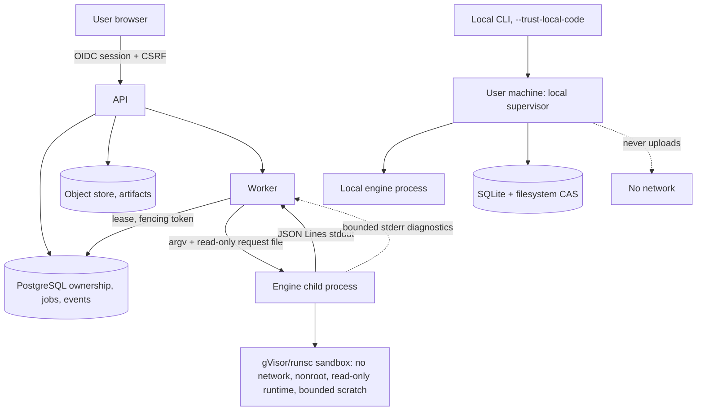

# Security and deployment

The system runs code it did not write. This document owns the trust and data-flow
model, the sandbox, the limits, least privilege, the deployment topology and
teardown. Requirements: [`../srs/security.md`](../srs/security.md),
[`../srs/platform.md`](../srs/platform.md). Decision:
[`../adr/0007-sandbox-and-local-runners.md`](../adr/0007-sandbox-and-local-runners.md).

## Trust and data flow

Unchanged in both paths: the supervisor owns the process and the limits; the
engine owns analysis only.

## Two execution modes

| | Hosted | Local |
|---|---|---|
| Code origin | Untrusted, uploaded by any user | The user's own code |
| Isolation | gVisor/runsc OCI, no network, non-root, read-only runtime | The user's machine and its own trust boundary |
| Consent | Implicit in uploading and running | Explicit `--trust-local-code` per invocation |
| GPU | Never | Only where the user opts in for that run |
| Persistence | PostgreSQL plus object store | SQLite plus filesystem CAS |

A sandbox failure makes a capability **unavailable**. It never falls back to
unsandboxed execution, and no configuration flag can enable that fallback.

## Sandbox contract

Inside the sandbox:

- **No network.** No sockets, no listener, no outbound connection.
- **Non-root identity.** No privilege escalation, no device mounts, no host
  filesystem mounts beyond the mapped read-only inputs and bounded scratch.
- **Read-only runtime.** The interpreter, libraries and compiler tooling are
  read-only; only the scratch and artifact directories are writable, and both are
  size-bounded.
- **Bounded resources.** Wall clock, memory, per-message size, output size and
  artifact size are enforced by the supervisor, which kills the process tree on
  breach.
- **No scenario authority.** The engine is launched with a fixed argv vector and
  a read-only request file. No command, path or environment variable from an
  uploaded scenario is executable authority.

Preflight is a gate: before a hosted profile that needs execution is offered, its
interpreter, `torch` and NumPy, its solver and any compilation path must be
demonstrated to work inside the deployed image with bounded writable scratch and
cache. The image digest is recorded in the profile revision. Pure symbolic
parsing may remain available independently, because it executes nothing.

## Resource enforcement

| Limit | Initial CPU-profile default | Raisable by a request? |
|---|---|---|
| Solver time | 30000 ms | No; operators may lower it. |
| Engine wall clock | 120000 ms | No. |
| Memory | 2147483648 bytes | No. |
| Message size | 1048576 bytes | No. |
| Output size | 16777216 bytes | No. |
| Artifact size | 268435456 bytes | No. |

Exceeding a process or resource limit fails the job with `ENGINE_FAILED` and an
explicit reason. Exhausting the **solver** budget is different: it produces an
`unknown` property result and is not an error at all.

## Least privilege

| Principal | May | May not |
|---|---|---|
| API | Read and write owned rows, authorize requests, issue lease-scoped job records | Read another owner's artifacts, execute user code |
| Worker | Read a leased job's inputs, write its results, commit its events | Hold identity-provider or billing credentials, read an unleased project's content |
| Engine | Read its request and mapped inputs, write scratch and artifacts | Hold accounts, publish, open a network connection |
| Local CLI | Act on the user's own files after explicit consent | Upload anything, run without consent |

## Import and parsing boundary

Every imported bundle, measurement, report and archive is untrusted:

- reject escaping paths, absolute paths, parent traversal and symlinks;
- reject conflicting identities, invalid content hashes, oversized payloads,
  malformed nesting and unsupported schema versions;
- never deserialize an executable object; no arbitrary Python pickle appears in
  any contract;
- never execute anything found in an import, and never publish on import.

An imported record keeps `origin: imported` permanently. Its provenance may be
complete, which is not the same as authentic, and it never becomes
provider-produced proof.

## Secret handling

Credential material, session tokens and database credentials never appear in job
logs, artifacts, error records or exports. Captured engine stderr and compiler
logs are passed through a redaction step for recognized secret patterns. A report
is meant to be shareable; a log that carries a token is not.

## Publication boundary

Publication is a disclosure operation. Source, paths, logs, hardware metadata and
witness details can each reveal something the owner did not intend, so each is
enumerated in the mandatory disclosure preview before anything becomes
retrievable. Access is authorized per request against ownership or an including
publication. Revocation denies subsequent server retrieval and makes no claim
about copies already obtained.

## Deployment and operations

The deployment needs PostgreSQL, an S3-compatible object store, the API and the
workers. It requires no proprietary cloud queue and no managed vendor service.
Workers are scaled by adding processes that lease rows. Queue depth and wait time
are visible facts about a deployment, which is why capacity figures are published
as measurements rather than promises.

### Teardown

- A cancelled or failed job's scratch is removed when its terminal state is
  committed; committed artifacts follow their retention class.
- A revoked publication stops being served immediately; stored bytes follow
  retention.
- A worker that dies mid-job leaves only a lease that expires and a job that
  finalises, plus whatever evidence it had already committed — which remains
  visible with its partial qualifier.
- No orphaned engine process survives: the supervisor kills the process tree on
  cancellation, on limit breach and on lease loss.
