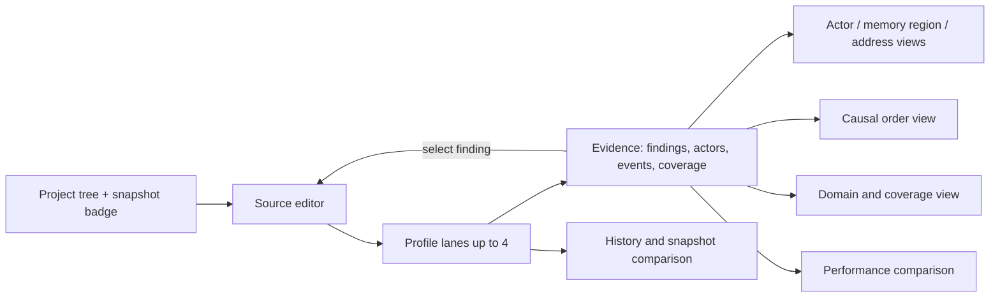

# Workbench

The React workbench maps the mock's visual intent onto real responsibilities.
The mock branch is a disposable maquette; this document is the specification.
Requirements: [`../srs/workbench.md`](../srs/workbench.md). Decisions:
[`../adr/0003-workbench-composition.md`](../adr/0003-workbench-composition.md),
[`../reference/compiler-explorer.md`](../reference/compiler-explorer.md).

## What is copied from the mock, and what is not

Anchors are in branch `web/mock` (read with `git show origin/web/mock:<path>`),
not in this tree.

| Copied | Anchor | Not copied | Anchor |
|---|---|---|---|
| Four-panel workbench: project, source, lanes, evidence. | `workbench.html:34-90` | The mock's single-`innerHTML` rewrite per state change with delegated listeners. | `js/workbench.js:149-155`, `222-232` |
| Spacing scale 4, 8, 12, 16, 24, 32. | `css/tokens.css:4-10` | Its Spanish fixture copy; the real UI starts in English. | `workbench.html` |
| Five semantic roles with fixed hue meaning across themes, and "green never stands alone for safe". | `css/tokens.css:39-45` | Its six staged lane labels and the 420 ms interval. | `js/scenario.js:65-67`, `js/workbench.js:12` |
| Comparison lanes capped at four. | `js/workbench.js:11` | Its pre-seeded finished lanes and seeded evidence rows. | `js/workbench.js:193-205`, `js/scenario.js:23-63` |
| Linked source and evidence selection. | `js/workbench.js:215-220` | Its asyncio scenario, profile list and evidence fixtures. | `js/scenario.js:1-21`, `js/profiles.js:26-164` |
| Support level and availability as separate axes. | `js/profiles.js:14-24` | Its `cancel`, which resets a lane to never-run and discards the attempt. | `js/workbench.js:176-180` |
| Unavailable profiles shown in the catalogue with the reason, not filtered out of the product. | `js/profiles.js:14-24` | Its `selectable` filter, which hides unsuitable profiles from the lane selector. | `js/workbench.js:21-25` |

The mock's `STAGES` array and `setInterval` advance are disposable: they cannot
represent a real queued or running job, and its `cancel` discards the attempt
rather than retaining partial evidence as cancelled. Real state comes from the
job event stream.

## Responsibilities

| Area | Owns |
|---|---|
| `apps/web/app` | The document, the client boundary, and mounting the workstation. |
| `apps/web/src/features` | Data access, state store, layout and the feature leaves. |
| `apps/web/src/features/editor` | Monaco integration. Editing only; it is not the analysis surface. It is mounted client-only, so it never enters the server render. |
| `packages/ui` | Tokens, primitives, lane and evidence components, shared with the read-only local viewer. |

The client is built as a static export and served by the workbench from the
API's own origin, so a browser reaches one host, one origin and one capability
([ADR-0014](../adr/0014-web-client-and-api-layers.md)).

The workbench renders. It never analyses, never measures and never decides
eligibility — those come from `packages/domain` and the engines.

## Views

### Navigation

Three experiences, and no second hierarchy: **Explore**, **Validate**,
**Optimize**. Execution mechanisms — `static`, `symbolic`, `instrumented`,
`benchmark`, `artifact` — appear as qualifiers on evidence, not as navigation.

### Lanes

Up to four lanes over the same scenario, each with its own profile revision, its
own real state and its own evidence. Selecting a lane selects its evidence without
discarding the others. Lanes for different backends appear side by side as
separate evidence about the same kernel, each carrying its own semantics; they are
never merged into one verdict or ranked into one list.

### Source, actor and memory

Selecting a finding highlights every actor, memory region, address and source range
it references; selecting a source range reveals the findings and events that
reference it. A finding with several actors highlights all of them. This
bidirectional link is the product's core interaction, not a convenience.

### Causal order

The event view renders only the ordering edges the analysis established, labelled
with the relation kind, and marks unresolved relationships as unresolved. It never
draws a timeline that implies an order among independent events, because a tidy
timeline is not evidence.

### Domain and coverage

Every property result shows its domain, its regions and its coverage next to the
outcome. Each region shows its per-property classification. Percentages appear
only where the domain is finite and enumerated with duplicates removed.

## Status roles

| Role | Meaning |
|---|---|
| `violation` | An actual violation. |
| `caution` | Potential, limited or untested. |
| `activity` | Queued or running. |
| `unknown` | Inconclusive, unsupported or unavailable. |
| `contract` | Declared or established, with visible assumptions. |

A role **decorates** an independent state and never replaces it with one green
"safety" label. Status is never carried by colour alone: text and, where useful,
shape carry it too.

## States

| State | Rendering |
|---|---|
| Empty result set | An explicit statement that no results exist yet, with the action that produces one. |
| Offline or unreachable service | An explicit offline state, not an indefinite spinner. |
| Wrong or unknown profile | `PROFILE_NOT_FOUND` with the requested id, never a nearby profile. |
| Unavailable capability | Present with its reason and the alternative that exists. |
| Budget-limited inconclusive | The result shown as unknown with the exhausted limit named. |
| Partially complete evidence | Shown as partial with its actual completeness. |
| Cancelled run | Visible, with the partial evidence it produced, never removed or replaced by a later run. |
| Stale snapshot | Old evidence remains displayable with a stale indicator naming its snapshot. |

Disabled controls state why they are disabled and what would enable them. They are
never present-but-inert.

## Publication

Publishing requires an explicit selection of a snapshot and artifacts, after a
disclosure preview listing what would become visible by category and count. The
published report preserves every qualifier — coverage, assumptions, budget,
evidence class — and publishing is never presented as an endorsement of the
kernel's correctness.

## Accessibility

- Keyboard alone reaches every finding, actor, source range, event and control.
- Findings, actors, ranges and events have meaningful accessible names.
- The layout reflows to a usable arrangement on a narrow viewport.
- The same components serve the hosted workbench and the read-only local viewer,
  so both get the same inspection acceptance. In the local viewer, write and job
  controls are unavailable with an explanation naming the CLI command that
  performs the operation instead.
