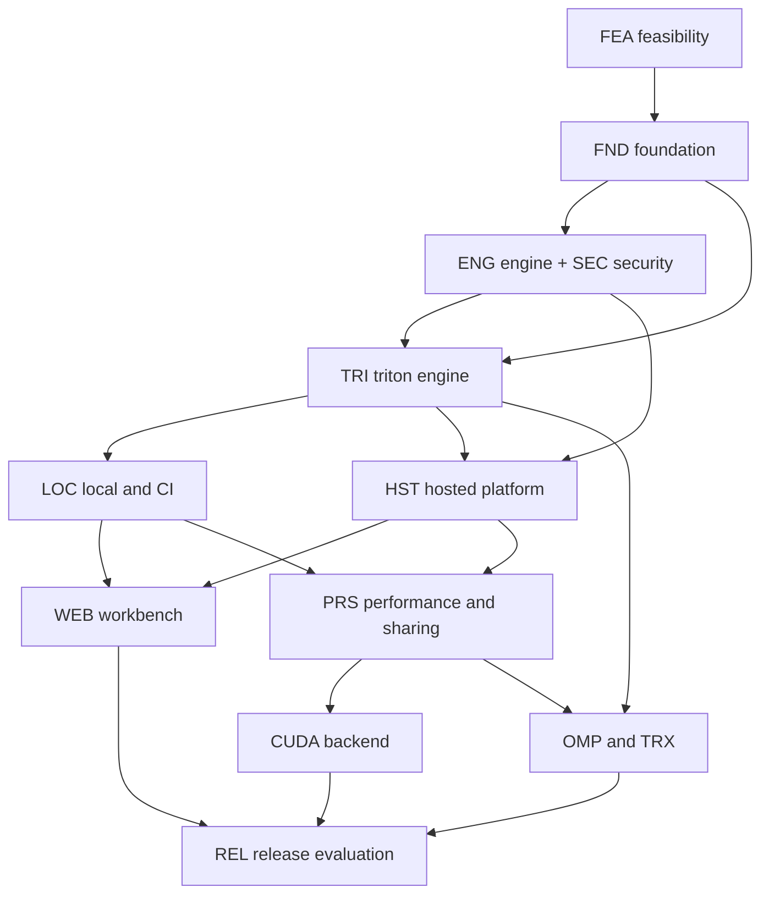

# Delivery

The backlog decomposes the whole product into runnable subtasks and gates. Every
task here specifies target behavior. A partial implementation exists; the
[audit ledger](../evaluation/reports/inventory.md) records target presence and
missing work without marking any task complete. The measured baseline gate is
no-go, so dependent implementation is stopped pending the listed unblock conditions.
Requirements are normative in [`../srs/`](../srs/README.md); decisions are in
[`../adr/`](../adr/README.md); behaviour specifications are in
[`../architecture/`](../architecture/README.md).

## Task format

Each task uses this shape. The heading form is three `#`, then `TASK-EPIC-NNN`,
then two spaces, then the imperative title.

```text
TASK-EPIC-NNN  Imperative title

**Purpose.** Why this task exists, in one or two sentences.
**Owns.** Future paths this task will create or change.
**Requirement links.** `REQ-...`
**Prerequisites.** `TASK-...` or "None (entry point)".
**Implementation.** Concrete edits and interfaces.
**Acceptance.** Observable result, not an internal assertion.
**Verification.** Environment and command that observes the acceptance.
**Artifacts.** What the task leaves behind for later tasks and users.
```

A task may declare an **empirical prerequisite** as blocked, but it must then
name the experiment and the observable unblock condition. "Blocked" is never a
substitute for a task.

## Epics, in delivery order

| File | Prefixes | Depends on |
|---|---|---|
| [`01-feasibility.md`](01-feasibility.md) | `FEA` | nothing; runs before application infrastructure |
| [`02-foundation.md`](02-foundation.md) | `FND` | `FEA` go decision |
| [`03-triton-engine.md`](03-triton-engine.md) | `TRI` | `FND` |
| [`04-local-ci.md`](04-local-ci.md) | `LOC` | `FND`, `TRI` (engine output) |
| [`05-hosted-platform.md`](05-hosted-platform.md) | `HST` | `FND`, `TRI`, `ENG` |
| [`06-workbench.md`](06-workbench.md) | `WEB` | `FND`, `LOC` (read-only transport), `HST` (job events) |
| [`07-performance-and-sharing.md`](07-performance-and-sharing.md) | `PRS` | `LOC`, `HST` |
| [`08-cuda.md`](08-cuda.md) | `CUDA` | `FND`, `PRS`, `ENG` |
| [`09-openmp-and-advanced-triton.md`](09-openmp-and-advanced-triton.md) | `OMP`, `TRX` | `FND`, `TRI`, `PRS` |
| [`10-release-evaluation.md`](10-release-evaluation.md) | `REL` | every preceding epic for the phases it exercises |
| [`11-engine-and-security.md`](11-engine-and-security.md) | `ENG`, `SEC` | `FND` |

`ENG` sits last in the file list because it is written as an integrated contract;
its tasks are prerequisites of `TRI`, `LOC` and `HST` work, which is why they
carry explicit prerequisites rather than relying on file order.

## Dependency DAG



## Milestones

| Milestone | Closes | Gate |
|---|---|---|
| M0 Feasibility | `FEA` | The research gate below. A no-go stops dependent implementation and preserves the specification. |
| M1 Foundation | `FND`, `ENG`, `SEC` | Contracts validate, generated bindings build, CI runs CPU-only. |
| M2 Local product | `TRI`, `LOC` | A supported fixture is analysed, validated, exported and served offline with correct exit statuses. |
| M3 Hosted product | `HST` | Auth, sandbox and artifact authorization precede public job acceptance. |
| M4 Workbench | `WEB` | Real engine output renders in the four-lane workbench, hosted and read-only local. |
| M5 Performance and sharing | `PRS` | Eligible measurement, publication preview, revoke and access checks. |
| M6 Native backends | `CUDA`, `OMP` | Vendor tooling produces genuine source-linked evidence with exact versions. |
| M7 Release | `REL` | Acceptance scenarios pass on the hardware that exists; missing hardware is a documented blocker. |

## Research gate

Proceed to the product build only when the feasibility epics show:

1. Real or faithfully reconstructed known-defect cases **and correct controls**
   produce source-linked, reproducible outcomes.
2. An independent comparison against existing tools at documented versions
   demonstrates at least one documented benefit: an additional supported defect
   class, a smaller witness, a lower comparable analysis or search cost, or a
   better explanation of the changing domain.
3. The correct controls are not misclassified in the chosen scope.

Publish measured limitations and case counts. Do not assert statistical
generality or novelty. If the gate fails, stop dependent implementation tasks,
preserve the completed specification, and do not substitute a different product.

## Rules that apply to every task

- No task is named "implement backend", "finish UI", "support CUDA", "write
  tests" or "production hardening". Each task is split at a real behaviour
  boundary.
- A task is independently executable from the architecture as written; it does
  not invent interfaces that the specifications do not define.
- Research uncertainty and implementing a chosen contract are separate tasks.
- Verification runs once, after the change, not mid-flight.
- No task may claim a result it did not observe. A missing device or tool is a
  blocker, recorded as a blocker.
